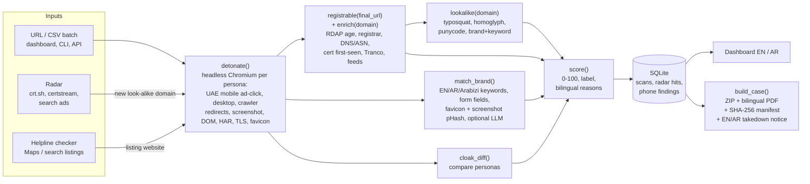

# ScamShield AI

**Detecting UAE brand-impersonation scams early, explaining each verdict in English and Arabic, and producing evidence the police can use.**
Built for the 42 Abu Dhabi x Abu Dhabi Police "ScamShield AI" hackathon by five final-year cybersecurity students.

> العربية: ScamShield يكشف المواقع والأرقام التي تنتحل صفة البنوك والجهات الحكومية في الإمارات، يشرح سبب الحكم بالعربية والإنجليزية، ويُصدر ملف أدلة جاهزاً للشرطة.

---

## 1. Why

Scams in the UAE rarely use new tricks. They copy brands people already trust: a bank login page, a TAMM or UAE PASS sign-in, an unpaid traffic fine or Salik toll, a parcel from Emirates Post. The links arrive by SMS, WhatsApp, social-media ads and sponsored search results. Fake "customer service" numbers are posted on Google Maps. Abu Dhabi Police has publicly warned about fake links in search engines and fake ads, and asks the public to report suspected fraud through its **Aman** service.

The pages are short-lived. A phishing domain is often registered, used and dropped within days, and many feed URLs are dead a few hours after they are reported. A useful tool therefore has to:

1. decide **from very little evidence** (the page may already be dead, blank or cloaked),
2. **never** flag the real bank or government site (one false positive on a real bank destroys trust),
3. find the domain **before** victims report it, and
4. produce an explanation and an evidence package an analyst can act on.

## 2. What: one pipeline, three surfaces

| Surface | Input | What it does |
|---|---|---|
| **Impersonation engine** | a URL (from a citizen report, SMS, ad, or a CSV batch) | Opens the link in an isolated headless browser as a UAE mobile user, follows every redirect and shortener, identifies which UAE brand the page claims to be, checks whether it is on that brand's official domain, and returns a 0-100 risk score with bilingual reasons. |
| **Early-warning radar** | Certificate Transparency (crt.sh backfill, certstream live), newly registered domain lists, search ads / organic results | Watches for newly issued certificates and new domains that contain UAE brand terms or look-alikes (`uaepass`, `tamm-`, `rta-fine`, homoglyphs, punycode). Every hit is pushed through the same scan pipeline. Records **time to detection** = flagged time minus the first-seen time reported by the source. |
| **Helpline checker** | Google Maps (Places) listings in English and Arabic across six UAE cities, search snippets | Normalises every phone number to E.164 (Arabic-Indic digits, 800/600 numbers, 05x mobiles, wa.me links) and compares it with the brand's official numbers and short codes. Listings' websites go through the same scan pipeline. |

All three surfaces end in the same place: a saved scan with a verdict, reasons and artifacts, which can be exported as a **police case file** (ZIP + bilingual PDF + takedown notice).

## 3. Architecture



Plain-text version:

```
 URL / CSV ──┐
 Radar hit ──┼─> detonate() x personas ─> registrable(final_url) ─> enrich(domain)
 Helpline  ──┘        │                                                   │
  listing site        ├─> match_brand(det) ──┐                            │
                      ├─> cloak_diff(dets) ──┼─> score() ─> save_scan ─> dashboard / case file
                      └─> lookalike(domain) ─┘        ^                        (ZIP + PDF)
                                                      └── intel ───────────────┘
 Any stage that fails -> domain-only verdict (age, look-alike, TLD, hosting, cert first-seen, blocklists).
```

Code map:

| Folder | Responsibility |
|---|---|
| `scamshield/detonate/` | Playwright detonation, 3 personas, shortener expansion, redirect chain (HTTP / meta / JS), screenshot, DOM, HAR, TLS, favicon; `cloak_diff` |
| `scamshield/intel/` | RDAP (domain age, registrar), DNS / ASN, crt.sh certificate first-seen, Tranco rank, phishing feeds (OpenPhish, phishunt), optional urlscan / Safe Browsing |
| `scamshield/brand/` + `data/registry.json` | Registry of 31 UAE brands (112 official domains, 59 official phone numbers, each with a source link) + 1 fictional test brand; brand claim detection; look-alike / typosquat detection; favicon perceptual-hash match (24 brands) |
| `scamshield/score/` | Rule-based scoring engine, bilingual reasons |
| `scamshield/pipeline.py` | Orchestration, timeouts, caching, domain-only fallback |
| `scamshield/radar/` | Watchlist (registry terms + dnstwist permutations + UAE scam themes), CT collectors |
| `scamshield/helpline/` | Fake helpline detection (Places, search snippets, synthetic demo mode) |
| `scamshield/evidence/` | Case file: ZIP, bilingual PDF, takedown notices, manifest |
| `scamshield/api/`, `web/` | FastAPI backend, React dashboard (English / Arabic RTL) |

## 4. Key ideas

- **Brand claimed on a non-official domain = scam.** The engine asks two questions: *which brand does this page claim to be?* (Arabic, English and Arabizi keywords in title, text, form labels and URL; favicon and screenshot perceptual hashes; an optional LLM read of the page) and *is the final URL on one of that brand's official registrable domains?* A page that says "Emirates NBD - verify your card" on `enbd-secure-update[.]xyz` is a scam (+75), whatever else it looks like.
- **Official is legitimate, first.** If the final URL is on an official domain of *any* brand in the registry, the verdict is legitimate (-100) unless a blocklist names it. This rule runs before any other, so a real bank page that mentions another brand can never be called a scam.
- **Shared hosts never inherit trust.** `foo.vercel.app`, `bar.web.app`, `*.github.io` etc. are compared as their own registrable domain (Public Suffix List with private suffixes). A scam on a free host does not become legitimate because the platform is popular, and hosting on one adds a small risk weight.
- **An error is never a verdict.** If the page is dead, blank, times out or is cloaked, ScamShield still returns a **domain-only verdict** from domain age (RDAP), look-alike distance to UAE brands, TLD, hosting, first certificate date and blocklists. Dead phishing links are the normal case, not an edge case.
- **Survive redirects, shorteners and cloaking.** Shorteners are expanded; HTTP, meta-refresh and JavaScript redirects are followed and recorded hop by hop. The page is opened as different personas (UAE mobile user arriving from a Google ad with `ar-AE` locale and Dubai time zone; desktop; Googlebot). If the scam shows a login form to the mobile user but a harmless page to the crawler, that difference is itself a signal (`cloaking`, +25).
- **Look-alike domains.** Typosquats, homoglyphs, Arabic/Latin confusables, punycode (`xn--`) and "brand + keyword" patterns (`tamm-fines-pay`, `uaepass-login`) are matched against every registry brand.
- **Every reason is bilingual.** Each signal carries an English and an Arabic sentence, a weight and the evidence it came from. The dashboard switches fully to Arabic (RTL).
- **Evidence the police can use.** `build_case(scan_id)` produces a ZIP with screenshots, DOM, HAR, redirect chain, WHOIS/RDAP, verdict JSON, a bilingual PDF report, and English/Arabic takedown notices for the registrar and host, plus `manifest.json` with the **SHA-256**, size and UTC creation time of every file, the tool version and the case timeline (domain registered, certificate first seen, page captured, case generated); the manifest's own hash is in `manifest.sha256`, and missing artifacts are recorded explicitly. The PDF states how evidence was captured (isolated browser, no downloads, no form interaction) and flags captures that need manual review. Takedown notices are **drafts only, never sent automatically**, and legitimate verdicts get none.
- **Time to detection.** Radar hits store `first_seen` (certificate notBefore / registration date from the source) and `flagged_at`. The difference is shown on the dashboard, so speed is measured rather than claimed.
- **Fake helplines need two signals.** A number not in the registry is only *unverified*. It becomes *likely scam* only with an independent second sign: brand-named listing linking to a non-official site, a personal mobile for an institution, a new listing with few reviews, a website scored as scam, or WhatsApp-only contact.
- **Never invent an official fact.** Official domains and phone numbers in `data/registry.json` come with source URLs; anything not confirmed from an official source is left out and listed in `data/registry_todo.md`.

### Scoring summary

Score = 10 (base) + sum of signal weights, clamped to 0-100. Labels: `scam` >= 80, `likely_scam` >= 60, `suspicious` >= 35, else `legitimate`. The batch CLI counts `likely_scam` and above as a scam (`is_scam=1`) by default (`--threshold` to change).

| Signal (selection) | Weight |
|---|---|
| `official_domain` (final URL on a registry official domain) | -100 (decisive) |
| `brand_on_unofficial_domain` | +75 |
| `blocklist` (public phishing feed / Safe Browsing) | +60 |
| `very_new_domain` / `new_domain` / `recent_domain` | +30 / +18 / +6 |
| `lookalike_domain` | depends on match type |
| `cloaking` across personas | +25 |
| `ip_host` | +25 |
| `password_no_https` / `tls_error_sensitive` | +20 / +15 |
| `punycode` | +15 |
| `shared_host` | +12 |
| `asks_sensitive` (password, card, OTP, Emirates ID), `phishing_language` (EN/AR), `risky_tld`, `new_certificate` | +10 each |
| `popular_site` / `known_site` / `old_domain` / `ranked_site` | -45 / -25 / -15 / -10 |

The full list with Arabic text is in `scamshield/score/__init__.py`.

## 5. Setup

Requirements: Python 3.11+ (developed on 3.13), Node.js 18+ (only to build the dashboard), ~500 MB for Chromium.

**Windows (PowerShell or Git Bash)**

```bash
python -m venv .venv
.venv/Scripts/python -m pip install -r requirements.lock
.venv/Scripts/python -m pip install -e .
.venv/Scripts/python -m playwright install chromium
copy .env.example .env      # optional, all keys may stay empty
```

**Linux / macOS**

```bash
python3 -m venv .venv
.venv/bin/python -m pip install -r requirements.lock
.venv/bin/python -m pip install -e .
.venv/bin/python -m playwright install --with-deps chromium
cp .env.example .env        # optional
```

`make` works on both (the Makefile picks `.venv/Scripts/python` or `.venv/bin/python`). On Windows we used `mingw32-make`.

**Optional keys (`.env`)** — every one is optional; a missing key gives a labelled fallback, never a crash:

| Variable | Used for | Without it |
|---|---|---|
| `LLM_PROVIDER`, `LLM_API_KEY`, `LLM_MODEL` | LLM read of page text for brand claim / intent (page text is wrapped as data) | keyword rules (EN/AR/Arabizi) |
| `GOOGLE_PLACES_API_KEY` | live Google Maps listing search for fake helplines | labelled synthetic demo listings |
| `SERPAPI_KEY` | search ads / organic results for radar and helplines | CT-log radar only |
| `URLSCAN_API_KEY`, `SAFE_BROWSING_API_KEY` | extra reputation sources | public feeds only |
| `CERTSTREAM_URL` | live certificate stream (default `ws://localhost:8080/`) | crt.sh backfill |

For the live certificate stream, `docker compose up -d` starts `certstream-server-go` (see `docker-compose.yml`), which tails the public CT logs and serves certstream JSON on `ws://localhost:8080/` (the default `CERTSTREAM_URL`). Without it the radar still has the crt.sh backfill and the newly-registered-domain list.

Set `SCAMSHIELD_OFFLINE=1` to forbid all network access (used by the tests).

## 6. Run

```bash
make test     # = .venv/Scripts/python -m pytest -q                 full test suite (offline)
make demo     # = .venv/Scripts/python -m scamshield.api.demo        seed demo data, build UI, serve http://127.0.0.1:8000
make scan     # = .venv/Scripts/python -m scamshield.scan data/eval/sample.csv --out predictions.csv
make eval     # = .venv/Scripts/python -m scamshield.cli.eval data/eval/sample.csv
```

No `make`? Every target above is the plain python command after `=`. On Linux/macOS use `.venv/bin/python`.

**Scan a batch of URLs**

```bash
.venv/Scripts/python -m scamshield.scan data/eval/sample.csv --out predictions.csv
#   [--concurrency 4] [--personas uae_mobile_ad_click desktop crawler] [--threshold likely_scam]
```

Input: CSV with a `url` column (or a plain list of URLs). Output: one row per input row, in input order, with the input columns kept plus

| column | meaning |
|---|---|
| `url` | input URL |
| `label` | `scam`, `likely_scam`, `suspicious` or `legitimate` |
| `score` | 0-100 risk score |
| `is_scam` | 1 if label >= threshold (default `likely_scam`) |
| `mode` | `full` (page analysed) or `domain_only` (page dead / blank / cloaked) |
| `brand_id` | registry brand the page claims to be (if any) |
| `final_url` | URL after all redirects |
| `reasons_en`, `reasons_ar` | top reasons, ` | `-separated |
| `scan_id` | id for the dashboard and the evidence export |

The run is resumable: rows already in `--out` are skipped.

**Evaluate**

```bash
make eval        # = .venv/Scripts/python -m scamshield.cli.eval data/eval/sample.csv
#   prints precision / recall / F1 / FPR, confusion matrix, every FP and FN with reasons,
#   the same metrics with blocklist hits ignored (ablation), the domain-only subset,
#   then scans https://<domain>/ for every official domain in the registry: "official domains FP: x/N".
#   Writes data/eval/last_eval.json.
.venv/Scripts/python -m scamshield.cli.eval data/eval/holdout.csv --no-official   # held-out set
#   options: --threshold suspicious, --ignore-blocklist, --rescore (re-score stored scans, no network), --force
```

**Fake helplines**

```bash
.venv/Scripts/python -m scamshield.helpline --brand tamm --live --no-landing   # no key -> labelled synthetic fallback
.venv/Scripts/python -m scamshield.helpline --synthetic                        # all brands, demo data
```

**Radar** (also from the dashboard: *Early-warning radar -> Run crt.sh backfill*, or `POST /api/radar/backfill`)

```bash
.venv/Scripts/python -m scamshield.radar watchlist                 # watchlist stats (registry terms, permutations, themes)
.venv/Scripts/python -m scamshield.radar match uaepass-verify.example  # does a domain hit the watchlist?
.venv/Scripts/python -m scamshield.radar backfill --days 30        # crt.sh backfill, every hit scanned (--no-scan to skip)
.venv/Scripts/python -m scamshield.radar certstream --minutes 10   # live CT stream (needs `docker compose up -d`)
.venv/Scripts/python -m scamshield.radar nrd --days 4              # newly registered domains (whoisds daily list)
.venv/Scripts/python -m scamshield.radar search                    # sponsored / organic results (needs SERPAPI_KEY)
.venv/Scripts/python -m scamshield.radar feed --limit 50           # hits with first_seen, flagged_at, time to detection
.venv/Scripts/python -m scamshield.radar siblings <domain>         # domains sharing IP / name server / cert / favicon
```

**Police case file**

```bash
.venv/Scripts/python -m scamshield.evidence <scan_id>          # ZIP + PDF for an existing scan
.venv/Scripts/python -m scamshield.evidence --scan <url>       # scan, then export
.venv/Scripts/python -m scamshield.evidence --bundle <id> <id> # one ZIP for many cases + index.csv
```

**API** (FastAPI, `scamshield.api.app:app`): `POST /api/scan`, `POST /api/batch`, `GET /api/scans/{id}`, `POST /api/scans/{id}/case`, `GET /api/cases/{id}/{zip|pdf}`, `GET /api/radar`, `POST /api/radar/backfill`, `GET /api/helpline`, `POST /api/helpline/run`, `GET /api/brands`.

## 7. Measured results

<!-- RESULTS:BEGIN -->
### Fresh time-split blind set (2026-11-25), the most honest number

180 URLs (106 scam / 74 legit) in `data/eval/blind_20261125.csv`, frozen before scanning (sha256 in `data/eval/blind_20261125_README.md`) and never tuned on. Scams are phishing URLs first published after 2026-11-24 20:57 UTC (urlscan public `phishing` tag, CERT.pl, PhishStats, PhishTank). Legit rows are fresh deep pages from 25 UAE official sites (banks, government, telecom, airlines, couriers) plus 3 global sites, all taken from the sites' own links and sitemaps. No UAE-targeted phishing appeared in the feeds in that window, so the scam half measures global phishing.

| Mode | Blocklists | Threshold | Precision | Recall | F1 | FPR |
|---|---|---|---|---|---|---|
| no LLM | ignored | likely_scam (60) | 0.960 | 0.226 | 0.366 | 0.014 |
| no LLM | ignored | suspicious (35) | 0.983 | 0.547 | 0.703 | 0.014 |
| **LLM on** | **ignored** | **suspicious (35)** | **0.984** | **0.566** | **0.719** | **0.014** |
| LLM on | ignored | likely_scam (60) | 0.964 | 0.255 | 0.403 | 0.014 |
| LLM on | used | suspicious (35) | 0.984 | 0.594 | 0.741 | 0.014 |

- **Recommended cut-off: 35 (label `suspicious`) for alerts, `likely_scam` for takedown/evidence.** Every cut-off from 30 to 85 has the same single false positive and official pages all score 0, so raising the threshold buys no precision. Full sweep: `data/eval/blind_20261125_sweep.md`.
- **The one false positive** is a real RAKBANK co-branded credit-card page on airarabia.com (scam 85): a partner page that the "brand on non-official domain" rule does not yet understand.
- **The LLM changed 0 labels** on this set: it corroborated what the keyword rules found. The apparent +3 TPs between runs is re-scan variance of live pages (7 labels differed between two scans ~40 min apart).
- **Biggest misses:** dead/blank/timeout pages judged on the domain only (43), crypto drainers with no brand claim (23), and kits that redirect to the impersonated brand's real site (they inherit its reputation).
- **Official-domain sweep with the LLM on:** 0/112 flagged.
- **After the radar false-positive fixes** (same stored scans re-scored, no re-detonation): P **1.000**, R 0.566 at suspicious, R 0.245 at likely_scam, **FPR 0.000**. The airarabia.com co-brand page is now legitimate. Caveat: that page was one of the patterns in the fix brief, so this row is no longer strictly blind; the 0.984 row above is the blind number.

**LLM false-positive gate.** Before trusting the LLM we ran it on the three false-positive suites (112 official domains, 42 risky legitimate UAE logins, 45 official deep links): **0/199 flagged**. One legitimate page (smilesuae.ae) got a small score bump from LLM evidence alone, so LLM brand evidence is now gated: it can only corroborate a verdict that is already at least `suspicious` without it, and can never raise a legitimate page's score.

### Earlier sets (2026-11-24)

Real runs of `make eval` (`python -m scamshield.cli.eval`), latest 2026-11-24 20:43 UTC. `is_scam` = label `likely_scam` or `scam` unless stated. Raw output: `data/eval/last_eval.json`, `data/eval/last_eval_holdout.json`.

| Set | Blocklists | Threshold | Precision | Recall | F1 | FPR |
|---|---|---|---|---|---|---|
| **Held-out, first blind run** (n=79: 37 legit / 42 scam, 2026-11-24 20:18 UTC) | **ignored** | likely_scam | **1.000** | **0.619** | **0.765** | **0.000** |
| Held-out, first blind run | ignored | suspicious | 1.000 | 0.786 | 0.880 | 0.000 |
| Held-out, after one round of generalisation (no longer blind) | ignored | likely_scam | 1.000 | 0.714 | 0.833 | 0.000 |
| Held-out, after generalisation | ignored | suspicious | 1.000 | 0.857 | 0.923 | 0.000 |
| Held-out | used | likely_scam | 1.000 | 1.000 | 1.000 | 0.000 |
| Sample, tuned on (n=127: 68 legit / 59 scam) | ignored | likely_scam | 1.000 | 0.797 | 0.887 | 0.000 |
| Sample | ignored | suspicious | 1.000 | 0.898 | 0.946 | 0.000 |
| Sample | used | likely_scam | 1.000 | 1.000 | 1.000 | 0.000 |

**Official-domain sweep:** the home page of every official domain of every real brand in the registry was scanned: **0/112 flagged as scam.**

**How to read this honestly**

- **Headline = first blind run on the held-out set, blocklists ignored: precision 1.000, recall 0.619 (26 of 42 scams), F1 0.765, FPR 0.000.** That is what the page and domain analysis achieved on URLs it had never seen.
- After that run we broadened the global-brand keyword list (from public brand rankings, but informed by the held-out misses). The held-out set is therefore **no longer blind**; on it, recall rose to 0.714 (30 of 42). We show both and treat 0.619 as the honest number.
- **Why we ignore blocklists for the headline:** all scam URLs come from the public OpenPhish and phishunt feeds, and `intel` checks the same feeds. With blocklists on, recall is 1.000, but that mostly measures our feed lookup, not detection. In deployment feeds stay on, so the "used" row is what an analyst would see on already-reported links; the "ignored" row is the fair estimate for brand-new links nobody has reported.
- **No false positives** in any run: not on UAE bank / government / police / telecom pages, not on globally phished brands' real sites (Apple, PayPal, Netflix, Coinbase, Binance, WhatsApp), not on news pages that mention banks, and not on the official-domain sweep.
- The **held-out set** was built after tuning on `sample.csv`, from domains not in the sample. It is not time-split (the feeds had not rotated on 2026-11-25), so "unseen" means unseen domains, not a later time period.
- Feed labels are not hand-verified; sets are small (79 and 127 URLs). These are regression numbers, not a benchmark.
- Most misses without blocklists: old compromised sites hosting a kit in a sub-path, kits that show nothing to our mobile persona, brands outside our registry and global keyword list, and dead pages on registered-but-not-new domains (these usually reach `suspicious`, not `likely_scam`). Details in `data/eval/README.md`.
<!-- RESULTS:END -->

**Adversarial checks (breaker team, network suites run live):**
- **45/45** real UAE official deep links labelled legitimate.
- **42/42** "hard legit" pages labelled legitimate: real UAE government, university, exchange-house and SaaS login pages that look risky (login forms, UAE PASS sign-in buttons, regulator footers). This pass first found 12 false positives (UAE PASS SSO buttons, regulator footers, "etihad" used as an ordinary Arabic word), which were fixed before the final runs.
- **92** offline adversarial cases pass: IDN / homoglyph domains, combosquats, `user@host` URL tricks, obfuscated IP hosts, 12-hop redirect chains, persona cloaking, closed shadow DOM.

**Early-warning radar (2026-11-25, all keys set):** 3,436 hits (crt.sh 3,312, live certstream 62, Google organic results via SerpApi 59, newly-registered lists 3), 3,418 scanned. After the false-positive fixes: **388 scam, 296 likely scam, 2,376 suspicious, 358 legitimate.** Of the 388 scam verdicts, **371 were on no blocklist at report time** (our feeds: 0; Google Safe Browsing, fresh lookup of domain, host and final URL: 17). These radar verdicts are **not hand-verified**: a spot check of the first drain found many false positives (parking pages, defensive registrations, guides, banks' own cloud API hosts), which are now handled (scam 1,136 -> 388 on the same stored scans), but the remainder still needs an analyst. Report: `data/radar/drain_report_20261125_v2.md`.

- **Search ads:** 57 SerpApi searches (English + Arabic, google.ae, desktop + mobile) for UAE scam-intent queries such as card renewal, traffic fines, UAE PASS login, parcel fees. Google showed **0 ads** for all of them; 59 non-official organic results became radar hits.
- **Lead time** is not claimed: most hits come from a crt.sh backfill, so `flagged_at - first_seen` (median ~70 days) measures our backfill delay, not a head start.
- **Related domains:** the scan page lists domains sharing dedicated nameservers, IPs, certificates or favicons, e.g. one `aramex[.]rest` scan links 14 `etisalat-*[.]icu/cfd/click/sbs` look-alikes on the same nameservers.

**Fake helplines, live Google Maps (Places API):** 262 Maps listings checked for 3 brands (ADCB, FAB, Emirates NBD); 256 show the registry's official number, **6 show a different number** (branch or department lines, e.g. a "Collections & Recoveries" listing). They are listed for human review, not called scams. The registry has 0 brands marked `verified`, so the verified-only check ran on 0 brands; these 3 were checked in review mode.

Examples from the first evening (2026-11-24, verdicts as scored then):

| Source | Domain | Why it matched | Verdict | Time to detection |
|---|---|---|---|---|
| newly registered domains | `adinwealth[.]org` | look-alike of ADIB's `adibwealth.ae` | scam 87 | 4 d 20 h after the NRD list date |
| newly registered domains | `trafficrta[.]xyz` | RTA + traffic-fine theme | likely scam 70 | 2 d 20 h after the NRD list date |
| certstream (live CT) | `salik[.]work` | TLD swap of `salik.ae` | suspicious 53 | within the hour of certificate issue |
| crt.sh backfill (`uaepass`) | `uaepasses[.]com`, `uaepass[.]digital`, `uaepass[.]help` ... | UAE PASS keyword on non-official domain | scam / likely scam | not measured (backfill) |

Time to detection is quoted only where the start time is a CT log timestamp or a newly-registered-domain list date. The two NRD figures mostly reflect when we started watching (that afternoon), not how fast the radar can be. The radar also groups related domains into networks (for example the `a-track-au[.]com` / `p-track-au[.]com` / `s-track-au[.]com` cluster).

Not all radar verdicts are right. Some `uaepass` hosts look like legitimate third-party UAE PASS integrations: after re-scan `uaepass.hubpay[.]io` and `uaepass.appchecker[.]net` are suspicious 59, `uaepass.magure[.]ai` legitimate 25, and `uaepass.uat.finwall[.]studio` still scam 88 (unverified either way). Radar hits are not part of the precision numbers above, which is why the pilot keeps an analyst in the loop before any takedown.

**Engineering checks:** `make test` (offline, `SCAMSHIELD_OFFLINE=1`): 308 passed, 88 skipped (network-marked). Network suites run separately (87/87 passed; with the LLM on, 0/199 false positives). Detonation fast mode: 8 concurrent browsers, p50 6.4 s per URL, about 1 s per URL batch throughput.

## 8. Limitations (honest)

- **Small evaluation sets.** 127 tuning URLs and 79 held-out URLs. Enough to catch regressions and false positives on UAE official sites, not enough for a statistically strong accuracy claim.
- **Feed overlap.** Scam URLs come from OpenPhish and phishunt, which are also blocklist sources in `intel`. The headline number therefore ignores blocklists (`--ignore-blocklist`); with them, recall on these sets is trivially high.
- **Feed labels are not hand-verified,** and many feed URLs were already dead, so a large share of the scam set is decided by the domain-only path.
- **Few of the eval scams are UAE-branded.** Public feeds on a given day contain mostly global brands. The UAE-specific logic (registry, Arabic keywords, look-alikes) is exercised by the official-domain sweep, the legitimate UAE deep links, the fixtures and the radar's live hits, more than by the scam half of the eval.
- **Blind runs.** The held-out set was blind exactly once (recall 0.619); a fresh time-split set (2026-11-25, 180 URLs) was then built and never tuned on (recall 0.566 at the suspicious cut-off, 0.255 at likely_scam). Recall on brand-new global phishing at likely_scam is low; most misses are dead pages and phishing with no brand claim.
- **Registry is unverified by a human.** All 31 real brands carry `verified: false`; some facts were confirmed only from search excerpts because the official site blocked automated fetches (`data/registry_todo.md`, 23 open items).
- **Keyless mode.** Without an LLM key the brand claim uses keyword rules; without a Places key the helpline demo uses **labelled synthetic** listings; without SerpApi there is no ads radar.
- **Time to detection** is computed from certificate notBefore or the registration date given by the source. CAs often backdate notBefore (Let's Encrypt by one hour), so live certstream hits read ~59 minutes when the real lag is minutes. crt.sh's index lagged by weeks during the hackathon, so backfill hits measure coverage, not speed; we quote time to detection only for CT-log and NRD-list-date hits.
- **Visual similarity** relies on reference favicon hashes (`data/brand_assets/hashes.json`, 24 of 31 brands); screenshot similarity coverage is partial.
- **Cloaking** that targets specific IP ranges (for example only UAE residential IPs) is not defeated from a data-centre IP; personas change user agent, locale, time zone and referrer only.
- **Known misses:** old compromised sites hosting a kit in a sub-path, kits that show a blank page to our persona, brands outside the registry, some radar hits on wildcard-DNS hosts (e.g. `sslip.io`).
- **Rules, not a trained model.** Weights were set by hand and tuned on a small set; a pilot should re-tune them on labelled ADP data.

## 9. Pilot path (summary)

See [docs/pilot.md](docs/pilot.md). Phase 0: sandbox on public feeds and CT logs, no citizen data. Phase 1: analyst in the loop, case files sent to registrars, hosts and TDRA for takedown. Phase 2: connect to existing reporting channels (Abu Dhabi Police Aman service, the federal eCrime reporting platform) so citizen-reported links are scanned automatically. KPIs: time to detection, false-positive rate on official domains, time to takedown.

## 10. Safety and ethics

- **Passive collection only.** We read public feeds, Certificate Transparency logs, RDAP and DNS. We do not scan ports, brute-force, or attack any host, and we respect rate limits.
- **Scam pages are hostile input.** Only the detonator's headless browser touches them, with downloads disabled. We never submit their forms or type into them. Page text is treated as data, never as instructions, including when it is passed to an LLM (wrapped in `<page>...</page>`).
- **No replicas of real brands.** Tests for redirects and cloaking use a fictional brand, "Sandbox Bank / بنك التجربة", on a local fixture server. Accuracy tests use real public feed URLs and real official sites.
- **No invented facts.** Official domains and phone numbers must come from an official source; unconfirmed ones are left out.
- **Synthetic data is labelled** as synthetic everywhere it appears.
- **Evidence integrity.** Every exported file is hashed (SHA-256) in a manifest; timestamps are UTC.

## 11. Team

Five final-year cybersecurity students, 42 Abu Dhabi.

<!-- Team names: fill in before submission -->
