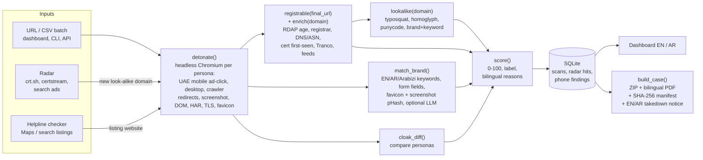

# ScamShield AI

**Detecting UAE brand-impersonation scams early, explaining each verdict in English and Arabic, and producing evidence the police can use.**
Built for the 42 Abu Dhabi x Abu Dhabi Police "ScamShield AI" hackathon by five final-year cybersecurity students.

> العربية: ScamShield يكشف المواقع والأرقام التي تنتحل صفة البنوك والجهات الحكومية في الإمارات، يشرح سبب الحكم بالعربية والإنجليزية، ويُصدر ملف أدلة جاهزاً للشرطة.

---

## 1. Why

Scams in the UAE rarely use new tricks. They copy brands people already trust: a bank login page, a TAMM or UAE PASS sign-in, an unpaid traffic fine or Salik toll, a parcel from Emirates Post. The links arrive by SMS, WhatsApp, social-media ads and sponsored search results. Fake "customer service" numbers are posted on Google Maps. Abu Dhabi Police has publicly warned about fake links in search engines and fake ads, and asks the public to report suspected fraud through its **Aman** service.

The pages are short-lived. A phishing domain is often registered, used and dropped within days, and many feed URLs are dead a few hours after they are reported. A useful tool therefore has to:

1. decide **from very little evidence** (the page may already be dead, blank or cloaked),
2. **never** flag the real bank or government site (one false positive on a real bank destroys trust),
3. find the domain **before** victims report it, and
4. produce an explanation and an evidence package an analyst can act on.

## 2. What: one pipeline, three surfaces

| Surface | Input | What it does |
|---|---|---|
| **Impersonation engine** | a URL (from a citizen report, SMS, ad, or a CSV batch) | Opens the link in an isolated headless browser as a UAE mobile user, follows every redirect and shortener, identifies which UAE brand the page claims to be, checks whether it is on that brand's official domain, and returns a 0-100 risk score with bilingual reasons. |
| **Early-warning radar** | Certificate Transparency (crt.sh backfill, certstream live), newly registered domain lists, search ads / organic results | Watches for newly issued certificates and new domains that contain UAE brand terms or look-alikes (`uaepass`, `tamm-`, `rta-fine`, homoglyphs, punycode). Every hit is pushed through the same scan pipeline. Records **time to detection** = flagged time minus the first-seen time reported by the source. |
| **Helpline checker** | Google Maps (Places) listings in English and Arabic across six UAE cities, search snippets | Normalises every phone number to E.164 (Arabic-Indic digits, 800/600 numbers, 05x mobiles, wa.me links) and compares it with the brand's official numbers and short codes. Listings' websites go through the same scan pipeline. |

All three surfaces end in the same place: a saved scan with a verdict, reasons and artifacts, which can be exported as a **police case file** (ZIP + bilingual PDF + takedown notice).

## 3. Architecture



Plain-text version:

```
 URL / CSV ──┐
 Radar hit ──┼─> detonate() x personas ─> registrable(final_url) ─> enrich(domain)
 Helpline  ──┘        │                                                   │
  listing site        ├─> match_brand(det) ──┐                            │
                      ├─> cloak_diff(dets) ──┼─> score() ─> save_scan ─> dashboard / case file
                      └─> lookalike(domain) ─┘        ^                        (ZIP + PDF)
                                                      └── intel ───────────────┘
 Any stage that fails -> domain-only verdict (age, look-alike, TLD, hosting, cert first-seen, blocklists).
```

Code map:

| Folder | Responsibility |
|---|---|
| `scamshield/detonate/` | Playwright detonation, 3 personas, shortener expansion, redirect chain (HTTP / meta / JS), screenshot, DOM, HAR, TLS, favicon; `cloak_diff` |
| `scamshield/intel/` | RDAP (domain age, registrar), DNS / ASN, crt.sh certificate first-seen, Tranco rank, phishing feeds (OpenPhish, phishunt), optional urlscan / Safe Browsing |
| `scamshield/brand/` + `data/registry.json` | 32-brand registry (31 UAE brands + 1 fictional test brand), brand claim detection, look-alike / typosquat detection, perceptual-hash visual match |
| `scamshield/score/` | Rule-based scoring engine, bilingual reasons |
| `scamshield/pipeline.py` | Orchestration, timeouts, caching, domain-only fallback |
| `scamshield/radar/` | Watchlist (registry terms + dnstwist permutations + UAE scam themes), CT collectors |
| `scamshield/helpline/` | Fake helpline detection (Places, search snippets, synthetic demo mode) |
| `scamshield/evidence/` | Case file: ZIP, bilingual PDF, takedown notices, manifest |
| `scamshield/api/`, `web/` | FastAPI backend, React dashboard (English / Arabic RTL) |

## 4. Key ideas

- **Brand claimed on a non-official domain = scam.** The engine asks two questions: *which brand does this page claim to be?* (Arabic, English and Arabizi keywords in title, text, form labels and URL; favicon and screenshot perceptual hashes; an optional LLM read of the page) and *is the final URL on one of that brand's official registrable domains?* A page that says "Emirates NBD - verify your card" on `enbd-secure-update.xyz` is a scam (+75), whatever else it looks like.
- **Official is legitimate, first.** If the final URL is on an official domain of *any* brand in the registry, the verdict is legitimate (-100) unless a blocklist names it. This rule runs before any other, so a real bank page that mentions another brand can never be called a scam.
- **Shared hosts never inherit trust.** `foo.vercel.app`, `bar.web.app`, `*.github.io` etc. are compared as their own registrable domain (Public Suffix List with private suffixes). A scam on a free host does not become legitimate because the platform is popular, and hosting on one adds a small risk weight.
- **An error is never a verdict.** If the page is dead, blank, times out or is cloaked, ScamShield still returns a **domain-only verdict** from domain age (RDAP), look-alike distance to UAE brands, TLD, hosting, first certificate date and blocklists. Dead phishing links are the normal case, not an edge case.
- **Survive redirects, shorteners and cloaking.** Shorteners are expanded; HTTP, meta-refresh and JavaScript redirects are followed and recorded hop by hop. The page is opened as different personas (UAE mobile user arriving from a Google ad with `ar-AE` locale and Dubai time zone; desktop; Googlebot). If the scam shows a login form to the mobile user but a harmless page to the crawler, that difference is itself a signal (`cloaking`, +25).
- **Look-alike domains.** Typosquats, homoglyphs, Arabic/Latin confusables, punycode (`xn--`) and "brand + keyword" patterns (`tamm-fines-pay`, `uaepass-login`) are matched against every registry brand.
- **Every reason is bilingual.** Each signal carries an English and an Arabic sentence, a weight and the evidence it came from. The dashboard switches fully to Arabic (RTL).
- **Evidence the police can use.** `build_case(scan_id)` produces a ZIP with screenshots, DOM, HAR, redirect chain, WHOIS/RDAP, verdict JSON, a bilingual PDF report, and English/Arabic takedown notices for the registrar and host, plus `manifest.json` with the **SHA-256**, size and UTC creation time of every file, the tool version and the case timeline (domain registered, certificate first seen, page captured, case generated); the manifest's own hash is in `manifest.sha256`, and missing artifacts are recorded explicitly. The PDF states how evidence was captured (isolated browser, no downloads, no form interaction) and flags captures that need manual review. Takedown notices are **drafts only, never sent automatically**, and legitimate verdicts get none.
- **Time to detection.** Radar hits store `first_seen` (certificate notBefore / registration date from the source) and `flagged_at`. The difference is shown on the dashboard, so speed is measured rather than claimed.
- **Fake helplines need two signals.** A number not in the registry is only *unverified*. It becomes *likely scam* only with an independent second sign: brand-named listing linking to a non-official site, a personal mobile for an institution, a new listing with few reviews, a website scored as scam, or WhatsApp-only contact.
- **Never invent an official fact.** Official domains and phone numbers in `data/registry.json` come with source URLs; anything not confirmed from an official source is left out and listed in `data/registry_todo.md`.

### Scoring summary

Score = 10 (base) + sum of signal weights, clamped to 0-100. Labels: `scam` >= 80, `likely_scam` >= 60, `suspicious` >= 35, else `legitimate`. The batch CLI counts `likely_scam` and above as a scam (`is_scam=1`) by default (`--threshold` to change).

| Signal (selection) | Weight |
|---|---|
| `official_domain` (final URL on a registry official domain) | -100 (decisive) |
| `brand_on_unofficial_domain` | +75 |
| `blocklist` (public phishing feed / Safe Browsing) | +60 |
| `very_new_domain` / `new_domain` / `recent_domain` | +30 / +18 / +6 |
| `lookalike_domain` | depends on match type |
| `cloaking` across personas | +25 |
| `ip_host` | +25 |
| `password_no_https` / `tls_error_sensitive` | +20 / +15 |
| `punycode` | +15 |
| `shared_host` | +12 |
| `asks_sensitive` (password, card, OTP, Emirates ID), `phishing_language` (EN/AR), `risky_tld`, `new_certificate` | +10 each |
| `popular_site` / `known_site` / `old_domain` / `ranked_site` | -45 / -25 / -15 / -10 |

The full list with Arabic text is in `scamshield/score/__init__.py`.

## 5. Setup

Requirements: Python 3.11+ (developed on 3.13), Node.js 18+ (only to build the dashboard), ~500 MB for Chromium.

**Windows (PowerShell or Git Bash)**

```bash
python -m venv .venv
.venv/Scripts/python -m pip install -r requirements.lock
.venv/Scripts/python -m pip install -e .
.venv/Scripts/python -m playwright install chromium
copy .env.example .env      # optional, all keys may stay empty
```

**Linux / macOS**

```bash
python3 -m venv .venv
.venv/bin/python -m pip install -r requirements.lock
.venv/bin/python -m pip install -e .
.venv/bin/python -m playwright install --with-deps chromium
cp .env.example .env        # optional
```

`make` works on both (the Makefile picks `.venv/Scripts/python` or `.venv/bin/python`). On Windows we used `mingw32-make`.

**Optional keys (`.env`)** — every one is optional; a missing key gives a labelled fallback, never a crash:

| Variable | Used for | Without it |
|---|---|---|
| `LLM_PROVIDER`, `LLM_API_KEY`, `LLM_MODEL` | LLM read of page text for brand claim / intent (page text is wrapped as data) | keyword rules (EN/AR/Arabizi) |
| `GOOGLE_PLACES_API_KEY` | live Google Maps listing search for fake helplines | labelled synthetic demo listings |
| `SERPAPI_KEY` | search ads / organic results for radar and helplines | CT-log radar only |
| `URLSCAN_API_KEY`, `SAFE_BROWSING_API_KEY` | extra reputation sources | public feeds only |
| `CERTSTREAM_URL` | live certificate stream (default `ws://localhost:8080/`) | crt.sh backfill |

For the live certificate stream run a local certstream server (for example the public `calidog/certstream-server` image with Docker, `docker run -p 8080:4000 calidog/certstream-server`) and point `CERTSTREAM_URL` at it. Without it the radar uses the crt.sh backfill.

Set `SCAMSHIELD_OFFLINE=1` to forbid all network access (used by the tests).

## 6. Run

```bash
make test                                   # full test suite (offline)
make demo                                   # seed demo data, build UI, serve http://127.0.0.1:8000
```

**Scan a batch of URLs**

```bash
.venv/Scripts/python -m scamshield.scan data/eval/sample.csv --out predictions.csv
#   [--concurrency 4] [--personas uae_mobile_ad_click desktop crawler] [--threshold likely_scam]
```

Input: CSV with a `url` column (or a plain list of URLs). Output: one row per input row, in input order, with the input columns kept plus

| column | meaning |
|---|---|
| `url` | input URL |
| `label` | `scam`, `likely_scam`, `suspicious` or `legitimate` |
| `score` | 0-100 risk score |
| `is_scam` | 1 if label >= threshold (default `likely_scam`) |
| `mode` | `full` (page analysed) or `domain_only` (page dead / blank / cloaked) |
| `brand_id` | registry brand the page claims to be (if any) |
| `final_url` | URL after all redirects |
| `reasons_en`, `reasons_ar` | top reasons, ` | `-separated |
| `scan_id` | id for the dashboard and the evidence export |

The run is resumable: rows already in `--out` are skipped.

**Evaluate**

```bash
make eval        # = python -m scamshield.cli.eval data/eval/sample.csv
#   prints precision / recall / F1 / FPR, confusion matrix, every FP and FN with reasons,
#   then scans https://<domain>/ for every official domain in the registry: "official domains FP: x/N"
.venv/Scripts/python -m scamshield.cli.eval data/eval/sample.csv --ignore-blocklist   # ablation without feed hits
```

**Fake helplines**

```bash
.venv/Scripts/python -m scamshield.helpline --brand tamm --live --no-landing   # no key -> labelled synthetic fallback
.venv/Scripts/python -m scamshield.helpline --synthetic                        # all brands, demo data
```

**Radar** (also from the dashboard: *Early-warning radar -> Run crt.sh backfill*, or `POST /api/radar/backfill`)

```bash
.venv/Scripts/python -m scamshield.radar watchlist                 # watchlist stats (registry terms, permutations, themes)
.venv/Scripts/python -m scamshield.radar match uaepass-verify.top  # does a domain hit the watchlist?
.venv/Scripts/python -m scamshield.radar backfill --days 30        # crt.sh backfill, every hit scanned (--no-scan to skip)
.venv/Scripts/python -m scamshield.radar certstream --minutes 10   # live CT stream (needs a certstream server)
.venv/Scripts/python -m scamshield.radar nrd --days 4              # newly registered domains (whoisds daily list)
.venv/Scripts/python -m scamshield.radar search                    # sponsored / organic results (needs SERPAPI_KEY)
.venv/Scripts/python -m scamshield.radar feed --limit 50           # hits with first_seen, flagged_at, time to detection
.venv/Scripts/python -m scamshield.radar siblings <domain>         # domains sharing IP / name server / cert / favicon
```

**Police case file**

```bash
.venv/Scripts/python -m scamshield.evidence <scan_id>          # ZIP + PDF for an existing scan
.venv/Scripts/python -m scamshield.evidence --scan <url>       # scan, then export
.venv/Scripts/python -m scamshield.evidence --bundle <id> <id> # one ZIP for many cases + index.csv
```

**API** (FastAPI, `scamshield.api.app:app`): `POST /api/scan`, `POST /api/batch`, `GET /api/scans/{id}`, `POST /api/scans/{id}/case`, `GET /api/cases/{id}/{zip|pdf}`, `GET /api/radar`, `POST /api/radar/backfill`, `GET /api/helpline`, `POST /api/helpline/run`, `GET /api/brands`.

## 7. Measured results

<!-- RESULTS:BEGIN -->
All numbers below are from real runs of `make eval` on `data/eval/sample.csv` (2026-11-24, ~20:03 UTC). Threshold: `likely_scam` or above counts as scam.

| Run | n | Precision | Recall | F1 | FPR | TP / FN / FP / TN |
|---|---|---|---|---|---|---|
| Full pipeline (blocklists on) | 55 | 1.000 | 1.000 | 1.000 | 0.000 | 26 / 0 / 0 / 29 |
| Ablation: blocklists ignored (`--ignore-blocklist`) | 55 | 1.000 | 0.115 | 0.207 | 0.000 | 3 / 23 / 0 / 29 |

**Official-domain sweep:** the home page of every official domain in the registry was scanned: **0/109 flagged as scam** (one, `moi-cpc.gov.ae`, was labelled `suspicious`: it redirects to `moi-cpc.ae` and the page timed out).

**How to read this honestly**

- **No false positives** on the 29 legitimate URLs (UAE banks, government, telecom, airlines, a news page that mentions banks) or on the 109 official-domain home pages. This is the property we optimised hardest.
- **The headline recall comes almost entirely from feed overlap.** The 26 scam URLs were taken from OpenPhish and phishunt, and `intel` checks the same feeds, so a blocklist hit decides most of them. With blocklists ignored, recall drops to **0.115** (3 of 26); 10 of the missed scams are still labelled `suspicious` (score 35-59), the rest `legitimate`. Most of these are dead or removed pages on free hosts (`pages.dev`, `netlify.app`, `vercel.app`) or non-UAE brands (Coinbase, Binance, Santander, iCloud, Microsoft), where our UAE registry gives no brand signal.
- In practice ScamShield is meant to run *with* feeds and the radar together; the ablation shows how much the page/domain analysis adds on its own, and where to improve (global-brand registry, free-host scoring, Tranco/RDAP lookup on sub-domains of shared hosts).
- n = 55 is small. Treat these numbers as a regression check, not a benchmark.
<!-- RESULTS:END -->

## 8. Limitations (honest)

- **Small evaluation set.** 55 URLs (29 legitimate, 26 scam). Enough to catch regressions and false positives on UAE official sites, not enough for a statistically strong accuracy claim.
- **Feed overlap.** The scam URLs come from OpenPhish and phishunt, which are also blocklist sources in `intel`. We report an ablation with blocklists ignored (`--ignore-blocklist`) so the detector is not graded on its own lookup.
- **Feed labels are not hand-verified,** and many feed URLs were already dead, so much of the scam set is decided by the domain-only path.
- **Few of the scams are UAE-branded.** Public feeds on a given day contain mostly global brands. The UAE-specific logic (registry, Arabic keywords, look-alikes) is exercised by the official-domain sweep, the fixtures and the radar, more than by the scam half of the eval.
- **Registry is unverified by a human.** All 31 real brands carry `verified: false`; some facts were confirmed only from search excerpts because the official site blocked automated fetches (`data/registry_todo.md`).
- **Keyless mode.** Without an LLM key the brand claim uses keyword rules; without a Places key the helpline demo uses **labelled synthetic** listings; without SerpApi there is no ads radar.
- **Visual similarity** needs reference hashes of each brand's favicon / header (`data/brand_assets/hashes.json`); coverage is partial.
- **Cloaking** that targets specific IP ranges (for example only UAE residential IPs) is not defeated from a data-centre IP; personas change user agent, locale, time zone and referrer only.
- **Rules, not a trained model.** Weights were set by hand and tuned on the same small set; a pilot should re-tune them on labelled ADP data.

## 9. Pilot path (summary)

See [docs/pilot.md](docs/pilot.md). Phase 0: sandbox on public feeds and CT logs, no citizen data. Phase 1: analyst in the loop, case files sent to registrars, hosts and TDRA for takedown. Phase 2: connect to existing reporting channels (Abu Dhabi Police Aman service, the federal eCrime reporting platform) so citizen-reported links are scanned automatically. KPIs: time to detection, false-positive rate on official domains, time to takedown.

## 10. Safety and ethics

- **Passive collection only.** We read public feeds, Certificate Transparency logs, RDAP and DNS. We do not scan ports, brute-force, or attack any host, and we respect rate limits.
- **Scam pages are hostile input.** Only the detonator's headless browser touches them, with downloads disabled. We never submit their forms or type into them. Page text is treated as data, never as instructions, including when it is passed to an LLM (wrapped in `<page>...</page>`).
- **No replicas of real brands.** Tests for redirects and cloaking use a fictional brand, "Sandbox Bank / بنك التجربة", on a local fixture server. Accuracy tests use real public feed URLs and real official sites.
- **No invented facts.** Official domains and phone numbers must come from an official source; unconfirmed ones are left out.
- **Synthetic data is labelled** as synthetic everywhere it appears.
- **Evidence integrity.** Every exported file is hashed (SHA-256) in a manifest; timestamps are UTC.

## 11. Team

Five final-year cybersecurity students, 42 Abu Dhabi.

<!-- Team names: fill in before submission -->
